<div align="center">

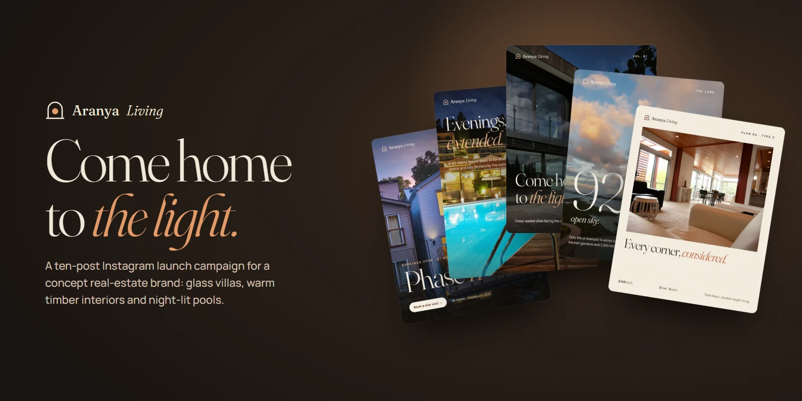

<br>

# Aranya Living

**A 10-post Instagram launch campaign for a concept luxury real-estate brand.**
Glass-walled villas, warm timber interiors and night-lit pools, sold through light rather than square feet.


[**See it live on my portfolio →**](https://guru1315-portfolio.vercel.app/graphic-designer)

</div>

---

## The brief

Aranya Living is a fictional developer launching courtyard homes and glass villas on the edge of Bengaluru. Most real-estate ads shout about prices and square feet. This campaign sells the feeling instead: **the morning light, the open sky, the evening by the pool.** Every post leads with one emotion, then backs it up with one hard fact.

> *"We bought the morning light. The house came with it."*

## The campaign

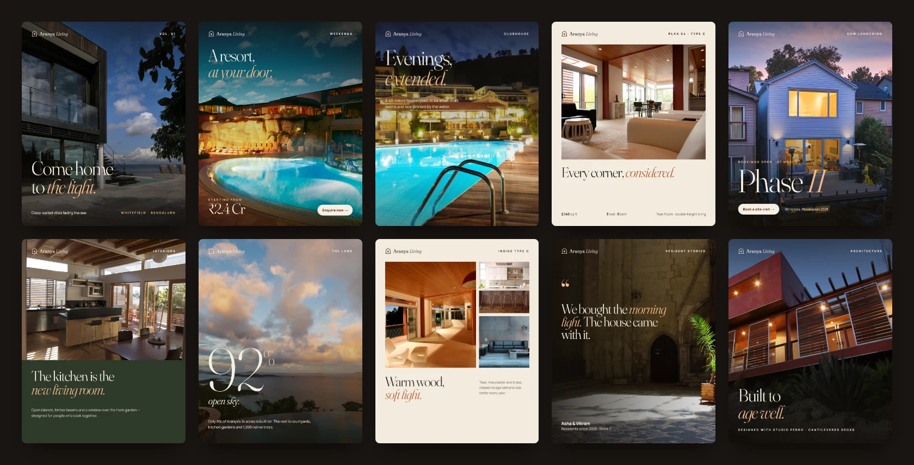

| # | Post | The job it does |
|:-:|---|---|
| 01 | **Come home to the light.** | The hero. Sets the promise: glass, sea, sky. |
| 02 | **A resort, at your door.** | Lifestyle plus price anchor: *from ₹2.4 Cr*. |
| 03 | **Evenings, extended.** | The clubhouse pool after dark. |
| 04 | **Every corner, considered.** | A floor-plan post: 2,140 sq ft, 3 bed, 3 bath. |
| 05 | **Phase II** | The launch announcement, with a *Book a site visit* call to action. |
| 06 | **The kitchen is the new living room.** | Interiors: open islands and timber beams. |
| 07 | **92% open sky.** | One big number about the land, told over the view. |
| 08 | **Warm wood, soft light.** | A materials collage of teak, plaster and brass. |
| 09 | **Resident story** | Social proof in the residents' own words. |
| 10 | **Built to age well.** | The architecture, at dusk. |

<details>
<summary><b>View every post full size</b></summary>
<br>

<p align="center">
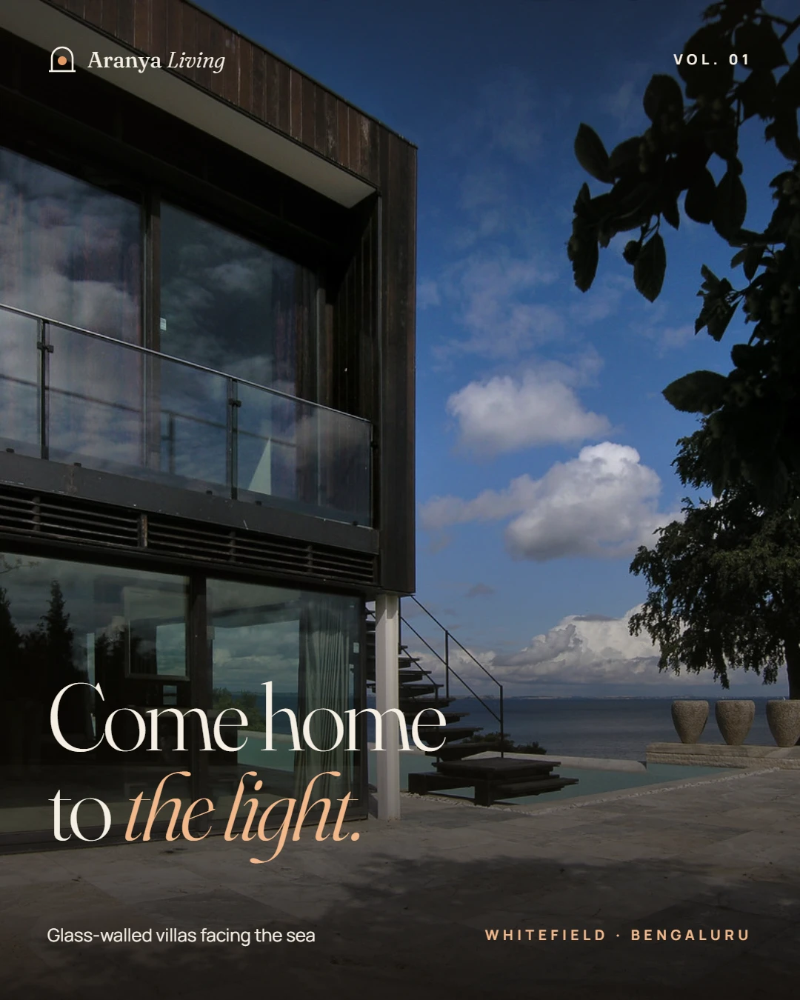
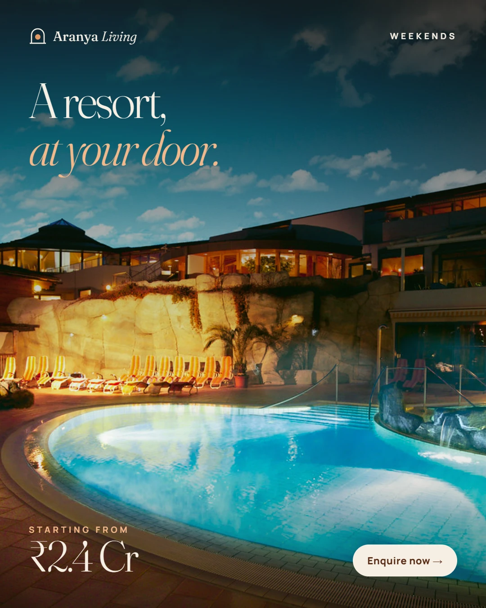
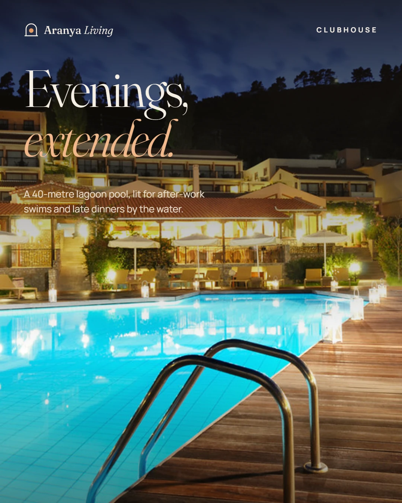
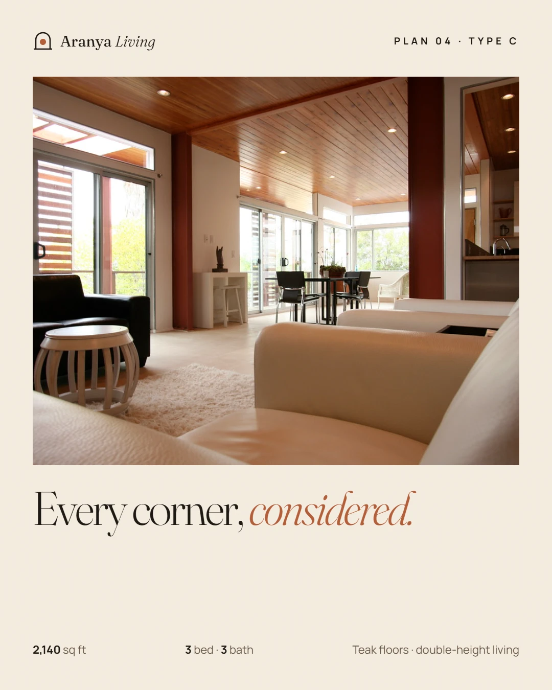
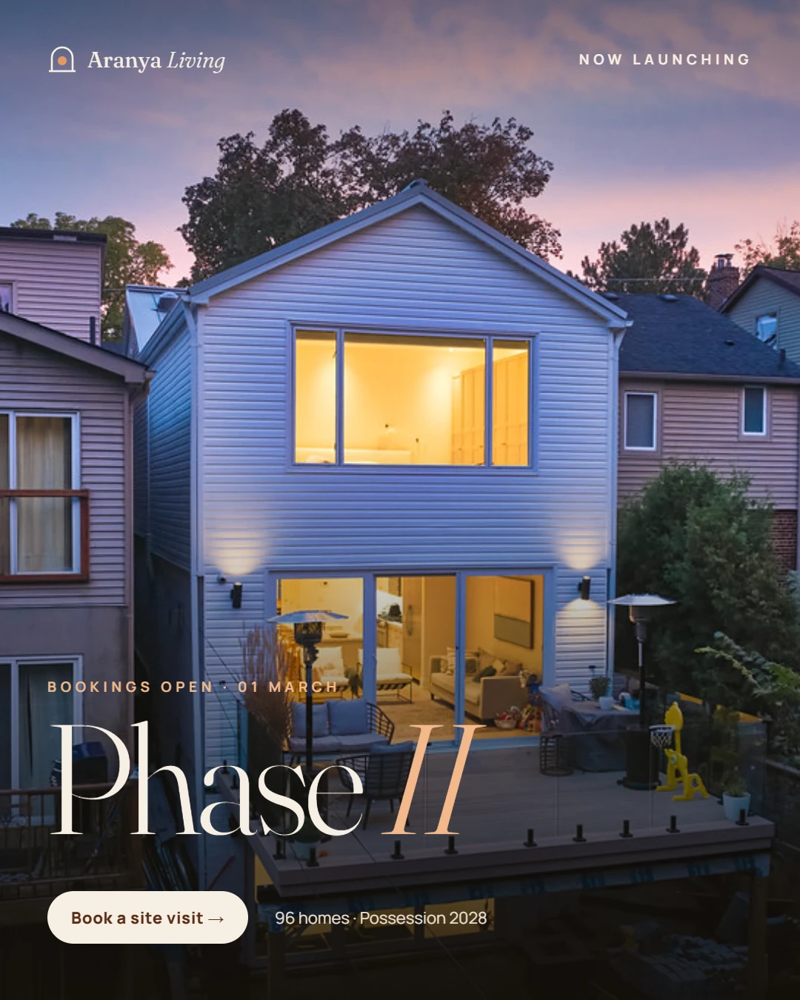
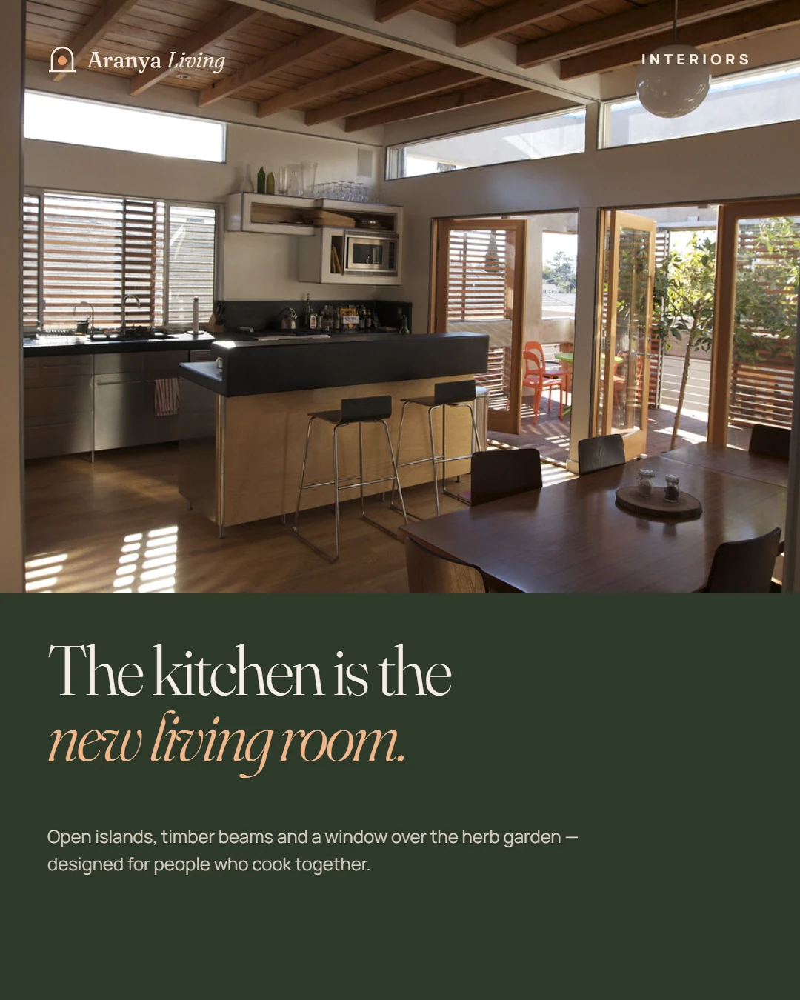
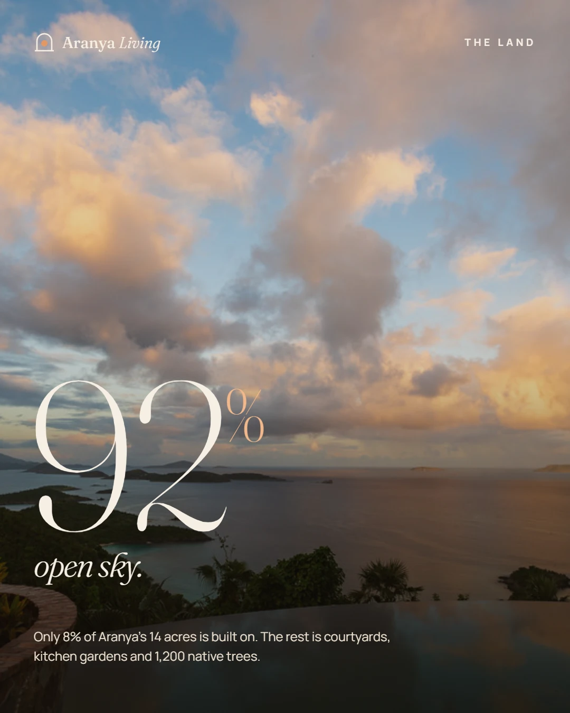
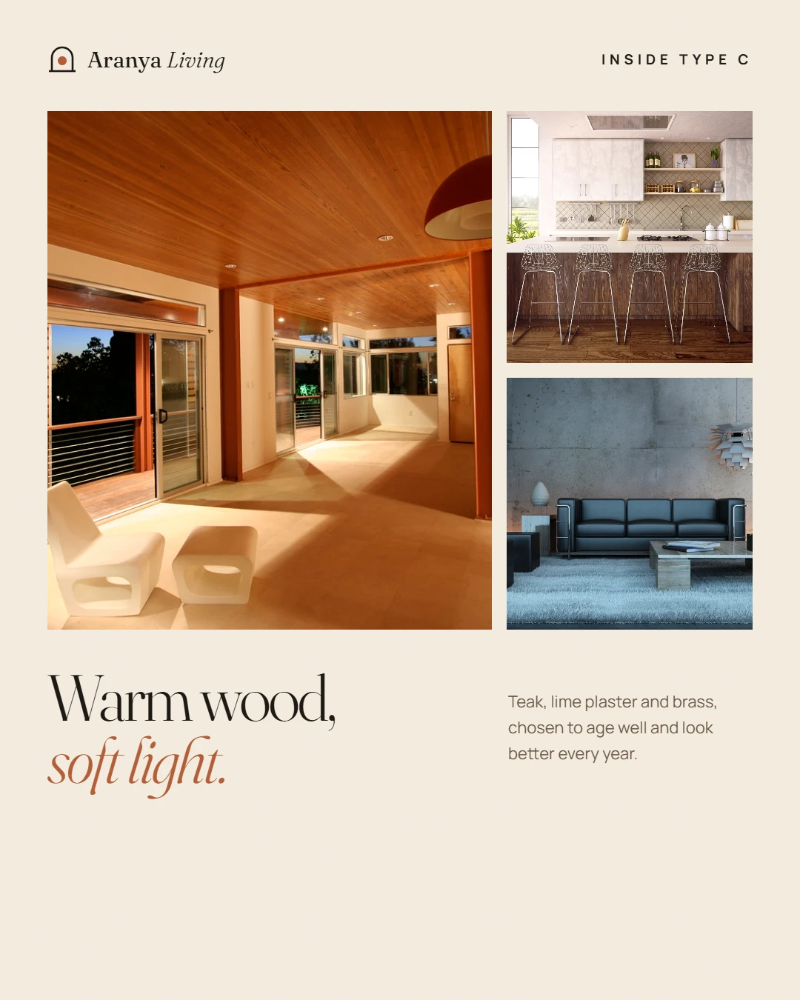
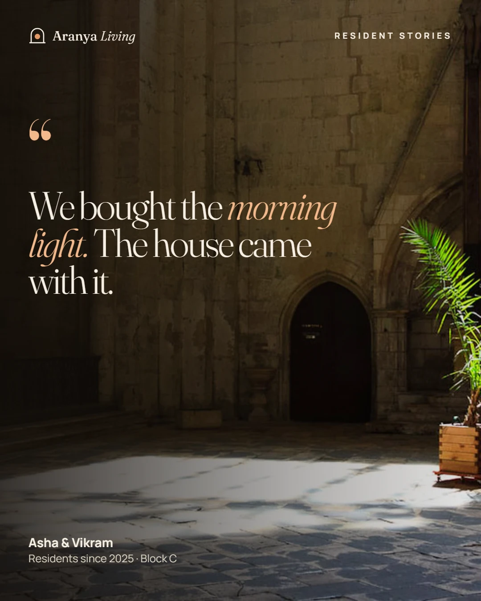
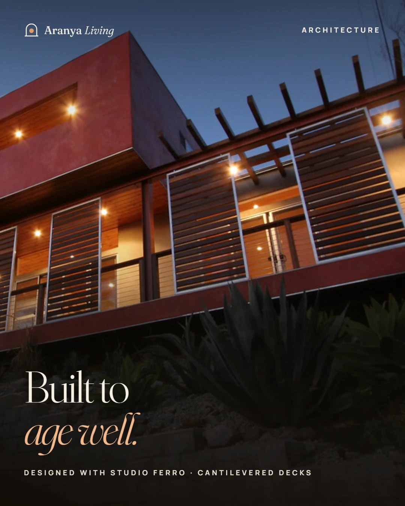
</p>

</details>

## Brand identity

<p align="center">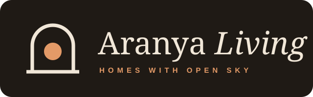</p>

**The mark** is an arched window with the sun sitting inside it: the whole idea of the brand in one shape. It reads cleanly at favicon size and holds up on photography ([logo on photo](brand/logo-on-photo.webp)).

### Colour

| | Name | Hex | Used for |
|:-:|---|---|---|
|  | Limewash | `#F6EFE4` | Type on photos, light layouts |
|  | Sunset clay | `#E39A67` | Accents, italic highlights |
|  | Terracotta | `#B4603A` | Accents on light layouts |
|  | Olive | `#2F3A2C` | Interior and garden posts |
|  | Charcoal earth | `#1F1A15` | Shadows, dark layouts |

### Type

- **[Fraunces](https://fonts.google.com/specimen/Fraunces)** (Light 300 with *Italic*): headlines. The italic carries the emotional word in every line (*the light*, *extended*, *considered*).
- **[Manrope](https://fonts.google.com/specimen/Manrope)** (500–800): body copy, prices and the spaced-out small caps labels.

### The rules the campaign follows

1. **One idea per post.** One headline, one supporting line, one fact.
2. **The italic word is the feeling.** The roman words around it are the facts.
3. **The photo does the selling.** Type sits in the shadows of the photo and never covers the subject.
4. **Same frame every time.** The logo sits top-left and a small-caps label top-right, so the posts read as one family in a grid.

## Repository

```
Aaranya-Living/
├── campaign/        10 finished posts, 1080 × 1350 (WebP)
├── brand/           logo.svg and the logo on photography
├── assets/          README banner and campaign grid
```

**[Portfolio](https://guru1315-portfolio.vercel.app)** · **[More graphic design work](https://guru1315-portfolio.vercel.app/graphic-designer)**

</div>
